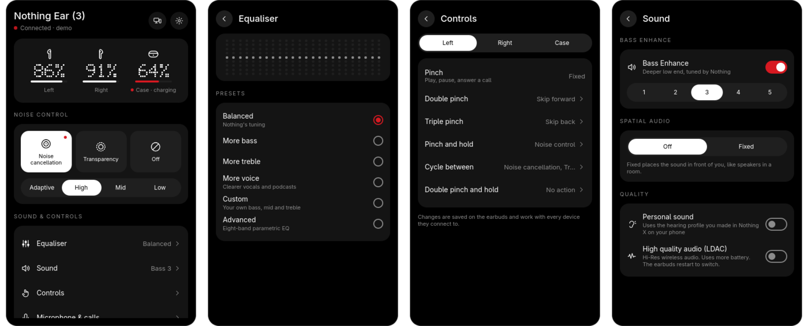

# Nothing X (desktop)

The Nothing X phone app's controls for Nothing earbuds, in a small tray popup
on your computer. Built and tested on **Omarchy** (Hyprland); the **Windows**
version is built from exactly the same source and QML, so both look and behave
the same.



Made for the **Nothing Ear (3)**, which gets every feature. Other Nothing and
CMF models are recognised and get the controls they have in common
(battery, noise control, EQ presets, in-ear detection, low lag).

> Unofficial and open source. Not affiliated with Nothing Technology Ltd.

## What it does

Nothing X starts with the computer and stays in the tray. While your earbuds
are connected, the tray icon *is* their battery level: a dot-matrix number for
the lower earbud, rounded to 5% (red at 20% and below). While they aren't, or
Bluetooth is off, it shows the earbuds struck through.

Click the tray icon and the popup opens under it. Click anywhere else, or press
Esc, and it closes. Right-click the icon for quick noise-control switching.

| Nothing X feature | Here |
|---|---|
| Battery: left, right, case, charging state | Home, the tray tooltip, and the tray icon itself |
| Noise control: noise cancellation (Adaptive, High, Mid, Low), Transparency, Off | Home, and the tray's right-click menu |
| Equaliser: Balanced, More bass, More treble, More voice | Equaliser |
| Custom EQ (bass, mid, treble) and the 8-band Advanced EQ | Equaliser |
| Bass Enhance (levels 1–5), spatial audio, personal sound, LDAC | Sound |
| Gestures: double pinch, triple pinch, pinch and hold (incl. noise-control cycle), double pinch and hold, per earbud | Controls |
| Case Talk button: press and hold (Essential Space, voice assistant) | Controls › Case |
| Super Mic, mic mode, call transparency, walkie-talkie mode | Microphone & calls |
| Ear tip fit test | Tools |
| Find my earbuds (ring left or right) | Tools |
| Dual connection, and connecting or disconnecting remembered devices | Tools |
| In-ear detection, low lag mode | Settings |
| Firmware version, serial number | Device information |
| Low battery notifications (20%, 10%) | App settings |

Firmware updates and creating a personal sound profile (a hearing test) still
need the phone app; the desktop app turns an existing profile on and off.

## Install on Omarchy

1. Install the one dependency Omarchy doesn't ship (Qt Bluetooth):

   ```sh
   sudo pacman -S --needed qt6-connectivity
   ```

2. Pair the earbuds once: open the case, hold its button for 2 seconds, and
   pair them from the bar's Bluetooth menu (or `bluetui`).
3. Build and install the package; it then appears in the app launcher
   (Super + Space):

   ```sh
   bin/install
   ```

4. Start **Nothing X** once from the launcher and pick your earbuds under
   Devices. From then on it starts with the computer (turn that off under
   App settings › Launch at login).

Optional: toggle the popup from the keyboard by adding a binding to
`~/.config/hypr/bindings.lua` (check `omarchy menu keybindings --print` for
a free combination first):

```lua
o.bind("SUPER + ALT + E", "Nothing X", "nothingx --toggle")
```

## Install on Windows

Pair the earbuds in Settings › Bluetooth & devices, then run the installer
(`NothingX-Setup-<version>.exe`). Nothing X then starts at sign-in and lives
in the notification area; drag its icon out of the overflow (^) onto the
taskbar to keep the battery number always visible.

To build it yourself you need Qt 6.8 or newer for MSVC 2022 (with the Qt
Bluetooth module), Visual Studio 2022's C++ tools, and optionally Inno Setup 6.
From a *x64 Native Tools* PowerShell:

```powershell
.\packaging\windows\build.ps1 -QtDir C:\Qt\6.8.3\msvc2022_64
```

The GitHub Actions workflow in `.github/workflows/build.yml` builds and tests
both versions on every push.

## Command line

| Command | Does |
|---|---|
| `nothingx` | Start in the tray and open the popup (or toggle it if already running) |
| `nothingx --hidden` | Start in the tray only (used for launch at login) |
| `nothingx --toggle` / `--show` / `--quit` | Control the running instance |
| `nothingx --demo` | Simulated Ear (3), no Bluetooth needed |

| Key | In the popup |
|---|---|
| Esc | Back, or close the popup |
| Ctrl+Q | Quit |

## Troubleshooting

- **"Couldn't connect"**: the earbuds must be out of the case and connected to
  this computer as audio. Only one app at a time can hold the control channel.
  If the phone's Nothing X app has it, close that app or turn off Bluetooth on
  the phone for a moment.
- **No devices listed**: the earbuds have to be paired in the OS first; the app
  lists paired devices whose name looks like Nothing or CMF.
- **LDAC** switching restarts the earbuds; the app reconnects on its own.

## How it works

The app speaks Nothing's control protocol over Bluetooth RFCOMM (service UUID
`aeac4a03-dff5-498f-843a-34487cf133eb`, falling back to channel 15, which some
Ear (3) firmware needs). Frames are `55 | ctrl | command | length | sequence |
payload | CRC-16/MODBUS`. `src/protocol.cpp` is the whole codec, with tests
that check it byte for byte against frames captured from a real Ear (3).

```
src/protocol.*      framing, CRC, every command's payload (no Qt Bluetooth: pure and tested)
src/device.*        the earbuds' state, the command queue, the settings
src/bttransport.*   RFCOMM via Qt Bluetooth (BlueZ on Linux, WinRT on Windows)
src/demotransport.* a simulated Ear (3) for --demo and the tests
src/popupplacer.*   the tray flyout: layer-shell on Wayland, docked to the taskbar on Windows
src/qml/            the popup's pages
```

Platform-specific code is limited to popup placement, launch at login, and
reading the system accent colour; everything else is shared.

## Development

```sh
bin/build                 # build/nothingx
bin/test                  # protocol and backend tests, offscreen
build/nothingx --demo     # try the UI without earbuds
build/nothingx --screenshots /tmp/shots   # render every page to PNG
```

## Credits

The protocol knowledge comes from the community's reverse-engineering work.
This app is an independent implementation and copies no code from these
projects; thank you to their authors:

- [ear-web](https://github.com/radiance-project/ear-web) (AGPL-3.0): the most complete command map, including the Ear (3)
- [nothingctl](https://github.com/FormalSnake/nothingctl) (MIT): per-model frame tables used as test vectors
- [PairFree](https://github.com/Omega-Destroyer/PairFree) (GPL-3.0): the Nothing X command catalogue
- [BudsLink](https://github.com/maniacx/BudsLink) (GPL-3.0)
- [Gadgetbridge](https://codeberg.org/Freeyourgadget/Gadgetbridge) (AGPL-3.0): framing and CRC
- [EarA-linux](https://github.com/oneydef/EarA-linux), whose issue #29 has the real Ear (3) capture
- [ncr/omarchy-headphones](https://github.com/ncr/omarchy-headphones), [nada](https://github.com/chukfinley/nada), [nadamas](https://github.com/ezvk/nadamas) (MIT)

Theme-watching follows the pattern of Omarchy's own apps (Omacut, MIT,
David Heinemeier Hansson). Icons and the dot-matrix glyphs were drawn for this
project.

## License

Apache-2.0, see [LICENSE](LICENSE).
